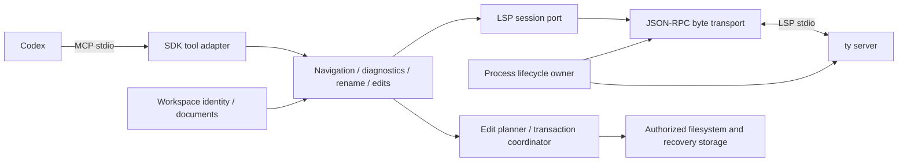

# gz-mcp-lsp reference parity and semantic-navigation specification

Revision 2, 2026-10-28. **DRAFT FOR HUMAN APPROVAL — implementation prohibited.**
The latest user direction supersedes revision 1's read-only scope: all six Go
reference tools, including diagnostics, rename and editing, are required functional
scope. This document and the [implementation plan](../plans/2026-10-28-reference-parity.md)
are review artifacts, not acceptance or permission to execute. Lite governance,
Superpowers design/planning, project/starter gates and disabled Backplane remain.

## Objective, baseline and deliberate stop

Independently implement the Python counterpart through: reference parity → correct
deficiencies → add the bounded ty navigation extensions → prove Codex interoperability
and correctness → stop. Semantic navigation remains the motivation; write tools
must be safe enough to include rather than quietly omitted. No source port/copy,
second server, network service, automatic dependency installation, code actions,
execute-command tool or general LSP framework.

The functional baseline is the latest published Go v0.1.1 at
`46e2950b7969334780675e7797e13f140d2d42ac`. Default main assessment commit is
`e4395849a52e18555361abab60a060802c06bf50`; only dependency metadata differs.
[Source-grounded parity matrix](../../discovery/reference-parity.md) owns P1–P6 and
S1–S6 traceability; [reference receipt](../../evidence/2026-10-28-reference-assessment.json)
records hashes/observed tests. No Go/ty or Python runtime acceptance has occurred.

Baseline: Python 3.14 family, selected managed CPython 3.14.10; uv/uv_build 0.13.6,
Ruff 0.17.3, ty 0.0.93, pre-commit 4.7.0, unittest, src packaging and project lock.
No Makefile or environment-variable application configuration. Official MCP SDK
candidate **mcp 2.3.0**, source `2118f14f8a19bc158d8a1cf90af58d85d187f849`;
ty integration candidate **0.0.93**, source `3db5e4df7becd3ca55fd06c78e98bf7c8a38e469`.
These versions were checked against official release sources; compatibility and
the SDK dependency graph remain to be tested after approval. No runtime dependency
or toolchain pin changes are made in this design assignment.

## Approach and responsibilities

Recommended proposal: official SDK MCPServer/stdio/lifespan plus a narrow stdlib
asyncio LSP client and filesystem adapters. The alternative is an evaluated Python
LSP client dependency, but none has demonstrated the needed transport, lifecycle,
licensing and Python 3.14 behavior. Owning a small tested wire implementation is
justified here; no framework, watcher library, registry or dependency injection layer.
This recommendation is an engineering decision for review, not previously granted approval.

| Boundary | Owns / forbids |
| --- | --- |
| Composition/config | Validated JSON, one workspace, explicit ty executable and state directory, budgets; no global chdir, env overrides or downloads |
| MCP | SDK negotiation/registration/schemas, cancellation and MCP errors, conservative annotations; no direct disk writes or name-to-position guessing |
| Operations | Exact LSP methods, semantic/result normalization, bounded source/context presentation; no SDK or subprocess dependencies |
| LSP session/transport | IDs, frames, callbacks/capabilities, pending futures, ordered writes/deadlines; no ty project logic or filesystem mutation |
| Documents/workspace | Canonical local identity, byte snapshots/hash, UTF-16 mapping, negotiated didOpen/change/close, bounded dependency generation |
| Lifecycle | One live child and reader/stderr tasks; initialize/ready/failure/shutdown/reap; no semantic retries after mutation |
| Edit planning | Pure range/overlap/version validation, before/after byte computation and plan digest; no effects |
| Filesystem transaction | Authorized regular files, staging/journal/recovery, serialized commits, honest outcomes; no LSP or MCP knowledge |

Use dataclasses, functions and narrow Protocol seams, defined in the plan only
where testing/substitution needs them. Modules are proposed, not created here.

## Proposed public contract and functional compatibility

Keep names `definition`, `references`, `diagnostics`, `hover`, `rename_symbol`,
`edit_file`; add exactly `document_symbols`, `workspace_symbols`, `implementations`.
This is **behavioral parity**, not a drop-in Go JSON/prose API. URI/position replaces
symbolName, inputs use snake_case and integer coordinates, results are structured.
Name discovery composes workspace_symbols with a caller-selected exact position;
no automatic first-match, full-range-start or fixed-column fallback.

All semantic input positions are zero-based `Position(line, character)` with
UTF-16 code units, and ranges are end-exclusive. Tabs count as code units, not
visual width. Accept only nonnegative integers (not bool/floats); reject invalid
lines/offsets, surrogate splits and malformed URI percent escapes. Only negotiate
UTF-16 initially; reject a server selecting another encoding. Preserve original
URI, full range and identifier selection range separately, including LocationLink
origin/target variants. A workspace symbol with only URI remains unresolved unless
an advertised resolve request supplies a real range; never label its full range
as an identifier selection.

| Tool | Proposed inputs and required result |
| --- | --- |
| definition | uri, position, context_lines=0; LSP definition → ordered target locations, range/selection_range and authorized declaration source, source_scope/completeness/hash |
| references | uri, position, include_declaration=false, context_lines=0; exact LSP reference locations plus optional bounded source context |
| diagnostics | uri, context_lines=0; current full diagnostic list with range/severity/code/source/message, result_id and document hash; no sleep/cache-empty-as-clean |
| hover | uri, position; original content form/kind/value(s), optional range; inferred type/signature remains server text, not a guessed normalized type API |
| rename_symbol | tagged request: preview(uri, position, new_name) or apply(plan_id); preview resolves and validates complete WorkspaceEdit; apply never recomputes edits behind an approved preview |
| edit_file | tagged request: preview(uri, edits[{range,new_text}], expected_hash) or apply(plan_id); existing file only; empty new_text deletes, zero-length range inserts, explicit EOF range appends |
| document_symbols | uri; hierarchy or flat symbols with distinct full and selection ranges |
| workspace_symbols | query, resolve=false; ambiguity retained, deterministic ordering, resolution only when supported |
| implementations | uri, position; ty subclass/member override locations, empty/unsupported distinction |

An edit range can express every valid upstream line replacement/delete/append;
no extra legacy line-edit parser or silent clamping. Text after a range's end is
preserved exactly. New text is UTF-8 text with explicit `\n`/`\r\n`; no implicit newline
normalization. Existing delimiter/EOF bytes outside edited ranges remain unchanged.
Mixed-newline documents are accepted with exact offset mapping; a range excludes
line terminators unless it spans to the next line. Preserve existing file mode.

Success envelope: schema_version=1, operation, position_encoding="utf-16", result,
workspace_generation, documents (URI/hash/version when relevant), complete=true.
Return MCP structuredContent and equivalent JSON text content for compatible hosts;
no timestamps/random ordering in semantic data. Mutation plan_id/receipts are
explicit ephemeral identity. Sort location/diagnostic lists by URI/start/end and
stable tie-breakers; preserve symbol hierarchy and unmodified hover/source text.
Null/no match is a successful empty/null result. Too-large results return
RESULT_LIMIT, never a silently truncated successful reference/rename set.

Errors use MCP isError with schema_version=1, operation, error{code,message,retryable,
details}; details contain no raw trace/source by default. Codes: INVALID_INPUT,
OUTSIDE_WORKSPACE, UNSUPPORTED, SOURCE_UNAVAILABLE, STALE_DOCUMENT, WORKSPACE_BUSY,
LIMIT_EXCEEDED, RESULT_LIMIT, TIMEOUT, CANCELLED, SERVER_EXITED, PROTOCOL_ERROR,
MUTATIONS_DISABLED, PLAN_EXPIRED, CONFLICT, APPLY_FAILED_ROLLED_BACK,
RECOVERY_REQUIRED. SDK handles malformed MCP envelopes; domain failures are not
empty-list success. Mutation receipts distinguish committed, no_op, rolled_back,
recovery_required; unsupported rename/no occurrences is explicit, never success prose.

Defaults for review: 20s initialize/request, 3s graceful shutdown + 2s escalation;
4 KiB LSP headers, 16 MiB frame, 2 MiB/file, 64 MiB workspace source scan,
10,000 eligible files, 1 MiB result including source/context, 8 in-flight reads,
1 commit, 100 files/1,000 edits/8 MiB staged mutation, 256 MiB retained state. context_lines 0..20.
Allow JSON to reduce limits; increases require operator configuration and evidence.
No implicit pagination of a mutation or partial rename plan.

## Definition/source and diagnostics parity details

P1 requires source, not just a location tool. After resolving exact definition,
use document symbols to find the smallest containing declaration with matching
selection range; retain its complete full range. For valid Python functions,
classes and assignments lacking sufficient server symbol ranges, a small Python
AST source-extraction adapter may identify the containing declaration and decorators.
AST UTF-8 byte columns must be mapped independently from LSP UTF-16 offsets.
Never use extracted declaration start as a subsequent semantic query position.
No regex bracket balancing. If source is inaccessible/external, syntax is incomplete,
or bounds exceed limits, return source_status/source_scope explicitly or a size
error; never claim complete implementation. Acceptance requires complete source
for supported in-workspace function/class/constant fixtures, including nested and
decorated definitions. External targets return metadata only, no external reads.

P3 uses advertised textDocument/diagnostic; full reports replace the per-document
cache, unchanged reports are legal only with a matching prior resultId and same
workspace/document generation. Otherwise request a new full report or fail protocol
validation. relatedDocuments receive the same identity policy. Invalidate on disk,
config or dependency change. Push diagnostics may be drained but do not substitute
for ty's pull response. No fixed sleeps. Generic push-only-server support is outside
the initial ty-only contract, not a reason to remove diagnostics.

## Workspace identity, freshness and synchronization

One canonical root (resolved once from trusted JSON), one saved-disk workspace,
no unsaved editor overlay. All input URIs must be local file URIs with empty
authority; no remote/UNC, query or fragment. Decode once, reject NUL/traversal,
symlink components and nonregular files. Canonical containment uses path components,
not string prefixes. Return external LSP targets as marked metadata; never open
or edit them. Case/percent-encoding aliases must not bypass duplicate edit detection.

Use bounded stdlib scans of .py/.pyi plus pyproject.toml/ty.toml and configured
project configuration inputs, with explicit JSON exclusions. Exclude VCS, adapter
state and dependency environments; those environments are immutable during a
session. Scanned source scope must agree with configured ty project scope; if it
cannot be established, fail WORKSPACE_BUSY/UNSUPPORTED rather than claim freshness.
Hash file bytes, identity and relevant configuration, not mtime alone. Do not
eagerly open every source document. Missing/unreadable/oversized scope fails visibly.

Recommended conservative baseline: rescan before semantic calls/rename preview,
serialize generation transitions, and **restart ty on any observed source/config
manifest change** before accepting new requests. At most one child live; wait for
old child reaping. This replaces the earlier unresolved reliance on unopened-file
watching with an explicit, testable saved-file contract, at a performance cost.
Reopen only needed documents in the new session; send didOpen once/version 1 and
didClose on eviction/shutdown. The document adapter must honor negotiated full or
incremental changes when an adapter-controlled committed edit is synchronized;
a generation restart remains the consistency barrier before subsequent semantic
results. Never claim background live-watcher parity as an algorithm requirement.

After each query rescan; if the manifest changed during the request, discard
its result as STALE_DOCUMENT and invalidate affected state. No unbounded automatic
retries. This detects observed changes, not an atomic snapshot of a hostile,
concurrently rewritten filesystem or unsaved buffers. Receipt includes the observed
generation. Real ty tests must prove changes to unopened consumers, new/deleted/
renamed modules and project settings become visible after restart. If startup
indexing lacks a documented readiness barrier, prove request consistency with
fixtures; unsupported consistency blocks acceptance, not an arbitrary sleep.

## Transport, lifecycle and failure semantics

SDK lifespan owns Session NEW → STARTING → INITIALIZING → READY → STOPPING → CLOSED;
FAILED rejects admission and fails pending work. Launch `[ty_executable,"server"]`
without shell, child cwd=root, explicit configured Python environment as documented
in ty project settings; no environment-based app overrides. Do not import workspace
code. No subprocess installation or network listener. Provision dependencies
before launch. Drain bounded stderr separately; never print to MCP wire stdout.

Single reader; Content-Length counts UTF-8 bytes; bound header/body, reject
missing/duplicate/negative lengths, malformed JSON and invalid response IDs/forms.
Serialize complete frames. IDs map to pending futures; out-of-order responses
correlate correctly, unknown late responses do not recreate waiters. Register
handlers before initialize, initialize once/initialized once, negotiate capabilities
and sync/diagnostics. Do not copy gopls options or claim unsupported registration.
workspace/configuration answers exactly one value per requested item. Reject
unsolicited workspace/applyEdit with applied=false, even during rename. Unsupported
requests receive MethodNotFound; bounded harmless notifications can be ignored.

Cancellation/timeouts remove waiters, send $/cancelRequest as appropriate and
actually unblock tools. EOF, malformed stream, child death and stderr failure
end the session and fail all pending work. No transparent replay of mutation calls.
Parent stdin EOF/signals stop admission; complete/rollback any commit section
under its own bounded cleanup budget; close documents before shutdown, await
shutdown, exit, close pipes, wait/terminate/kill/reap. Cleanup is idempotent and
has one owner. Startup failure leaks no child. Automatic restart is only the
explicit workspace-generation transition above, never hidden failure recovery.

## Write authorization and transaction safety

Rename/edit are fully included. Tool names are always conservatively annotated
readOnlyHint=false, destructiveHint=true, openWorldHint=false; previews do not
cause dynamic read-only reclassification. Other tools readOnlyHint=true; hints are
not authorization or a sandbox. Project-owned configuration defaults mutations.enabled=false.
An operator explicitly enables writes, specifies writable_roots and recovery state
storage, and thereby delegates only that bounded authority. A model-supplied
`approved:true` is never accepted. A plan token proves content identity, not human
approval. Codex policies should require mutation approval; the adapter cannot infer
an authenticated human consent signal merely from tools/call. See
[official host options](https://learn.chatgpt.com/docs/extend/mcp#other-configuration-options).

Deny VCS/internal state/dependency environments, symlinks, hard-linked files
(st_nlink != 1), nonlocal/nonregular targets, outside writable roots, unreadable
or unwritable parents. All rename targets returned by ty are untrusted and must
pass the same checks. No create/delete/rename filesystem resource operations,
recursive directory operations or overwriting external files. WorkspaceEdit may
contain changes or documentChanges TextDocumentEdit, not contradictory duplicate
forms; honor non-null document versions, reject version/hash mismatch. Annotations
requiring confirmation remain preview-visible and included in approved digest;
unsupported edit shapes reject the entire plan. This boundary retains ty symbol
rename functionality and explicitly excludes incidental generic resource operations.

Preview: lock generation for planning, snapshot all affected files/identities and
hashes, validate positions/limits/overlap/new identifier, compute all after-bytes
in memory, and return complete affected-file list/diffs/base hashes. Reject a
same-position pair of inserts as ambiguous; adjacent end-exclusive edits are legal.
new_name must be a valid Python identifier and not a keyword; ty determines semantic
rename validity (prepareRename when advertised; actual rename errors still matter).
No recomputation on apply. Store immutable plan with digest, workspace/session
identity and expiry 10 minutes; max 32 retained plans. Session restart/config
change expires previews. A no-op plan reports no_op and writes nothing.

Apply: require enabled authority, exact existing plan_id and unchanged generation,
all file identities/bytes/modes/versions, capacity and directory safety. Serialize
with all adapter operations, and acquire the adapter's single-writer state lock.
Do all validation/staging before replacing any target. Stage after-images and
recovery before-images on the same local filesystem, durable journal in an
operator-owned private state directory outside source; verify recovery copies
before target writes. Preserve modes. Use per-file atomic replacement and fsync
files/directories; record each transition. After replacing all, verify postimage
hashes, durably record committed receipt and synchronize/invalidate LSP generation.
On ordinary failure restore only files still matching our written postimages,
verify restoration, return rolled_back. If restoration encounters an external
change or fails, return RECOVERY_REQUIRED, enumerate affected identities/statuses,
block all further mutations and require operator recovery. Never overwrite an
external writer's newer content to manufacture rollback success.

If cancellation arrives after replacement begins, shield commit/rollback long enough
to record an outcome. The host/SDK may already report cancellation; cancellation
is not proof of zero writes. A retry of the same plan_id retrieves the durable
receipt before preview-expiry/session checks and does not reapply.

On crash/restart inspect incomplete journals **before accepting mutations**;
reconcile before/after hashes, restore safe entries or stop for operator recovery.
Never automatically replay a partial transaction. A lost success response is
answered from a durable plan/transaction receipt on retry, never reapplied. Plan
expiry does not erase committed/recovery receipts; retain until explicit operator
acknowledgment/cleanup. State storage quota exhaustion fails before writes.
Staging/recovery source contents are private local data, never telemetry/public logs.

**Guarantee boundary:** ordinary validation failures change zero files; ordinary
commit failures either restore exact before-images or explicitly block in recovery.
There is no portable atomic multi-file filesystem transaction. A crash/external
observer may see intermediate replacements; no promise of cross-process serializability
against noncooperating writers. Require a quiescent workspace for mutation and
recheck identities immediately before replacement using POSIX directory-relative,
no-follow operations on supported hosts. If that safety precondition cannot be
maintained, writes stay disabled. Multi-file crash atomicity beyond this boundary
requires a different design/explicit human decision, not a hidden claim of parity.

## Engineering acceptance, fixtures and completion

The [acceptance matrix](../../discovery/acceptance-matrix.md) owns observable gates:
P1–P6 all required; S1–S6 corrections/extensions; protocol, safety, host and starter
acceptance are separate. Mock tests never certify real ty or Codex behavior.

After approval author tiny public fixtures: shared_runtime package defining
run_shared_cli and three importing/calling packages, same-name unrelated function,
nested/decorated/async declarations, class override, a diagnostic error/fix and
text edit/newline/Unicode cases. Never copy private package names/business logic
or pad to private line numbers. Assert exact three consumer call positions and
separately enumerated import/declaration occurrences; do not assume exactly three
LSP locations. Direct ty and adapter requests use the same explicit identifier
coordinate; record keyword-position control without assuming every ty version
returns empty. Spy tests prove forwarded coordinates, not an arbitrary +4 patch.

Use unittest/IsolatedAsyncioTestCase, fake byte streams and synthetic failure server
for protocol control; actual pinned ty fixtures and actual Codex discovery/invocation
for behavior. Test failed/denied mutations and crash recovery on disposable copies.
Read-only and write-enabled Codex profiles must both be observed, including denied
host approvals causing zero writes. Keep process logs/redacted transcripts and
before/after hashes as evidence, not registration counts. No second server.

Required engineering gate: uv locked execution, Ruff check/format, ty, unittest,
pre-commit, isolated uv_build sdist→wheel and installed distribution behavior with
only declared runtime dependencies. Deeper analyzer/coverage/mutation/dependency/
license checks remain on-demand acceptance, not additional routine hooks. Update
distribution guards (currently enforce no runtime dependencies) with SDK adoption;
never bypass them. Runtime imports must come from installed src package.

Cognitive qualification remains UNKNOWN/blocked: starter issue #1 is still open;
complexipy 8.3.0 failed keyword-condition qualification. gz-skills 0.8.0 selection
versus released 0.8.3 reconciliation remains open. Use gzs-update-dependencies
and canonical starter/native procedures for a separately reviewed reconciliation;
do not hand-edit cache/provenance or silently waive strict acceptance. Keep both
as named work packages with completion gates, owner tvproductions/maintainer.

Python 3.14: verify SDK annotation/schema introspection on actual CPython; use
asyncio task/subprocess cleanup, stdlib context managers/dataclasses/path handling
with current version semantics. No demonstrated need for interpreter pools,
free-threading, compression, executor buffers or template-string machinery.
Initial supported acceptance hosts proposed: macOS arm64 and Linux x86_64 local
filesystems. Windows may receive read-only support after its own protocol/URI test;
write safety remains disabled there until an equivalent guarded filesystem adapter
is verified. Do not claim universal portability from one host.

## Human review decisions and execution boundary

1. Approve behavioral parity with deliberate URI/position/structured-result schema
   changes, or request an explicit compatibility interface (never name-guess semantics).
2. Approve enabled-only preview/apply write flow and recoverable multi-file guarantee,
   quiescent-workspace assumption and POSIX write scope. Strong crash-atomicity or
   concurrent noncooperating writers require redesign before implementation.
3. Approve conservative rescan/restart saved-file consistency, external-target
   metadata-only policy, proposed size/time budgets and initial OS matrix.
4. Resolve ownership/availability of the qualified cognitive engine and approve
   the gz-skills reconciliation before claiming strict engineering acceptance.

The implementation plan covers all six tools and three extensions in finite phases;
no indefinite deferral. Terminal milestone: accepted reference parity, corrected
semantic targeting, accepted ty extensions, real Codex interoperability, engineering
evidence or clearly incomplete gates, and a deliberate stop. **Full milestone cannot
be claimed while required engineering gates are incomplete.** No automatic release,
second server, subsequent capability work or execution authorization follows.
