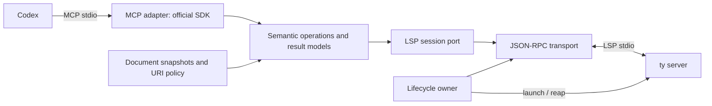

# gz-mcp-lsp initial architectural proposal

Date: 2026-10-28. **DRAFT — awaiting human review.** No accepted implementation
requirements or runtime capability claims. This is the requested initial proposal,
not an approved Superpowers implementation specification or implementation plan.
The user's initialization authorization covers repository scaffolding; it does
not authorize adapter implementation. After review, reconcile the chosen approach,
then follow Superpowers writing-plans before runtime work.

## Intent, constraints and evidence

Give Codex reliable semantic navigation by adapting MCP to an existing language
server. Preserve exact identifier targeting so cross-module references work
without fuzzy name resolution. The long-term consumer interface can be reusable
across AI coding agents, but initial scope is Python, Codex, one local workspace
and one independently provisioned ty server process. No diagnostics product,
editing/refactoring tools, installation during requests, network service, hosted
infrastructure or generalized orchestration framework.

Verified discovery: official ty documentation lists definition, references,
hover, document/workspace symbols and implementation support. LSP 3.17 defines
URI/position inputs, position-encoding negotiation, full/selection ranges,
capabilities and document sync. MCP SDK release v2.3.0 and its documented stdio,
lifespan and structured-output facilities are available. These observations do
not prove behavior of the selected ty/SDK combination. See
[reference review](../../discovery/reference-review.md) and
[initialization evidence](../../evidence/2026-10-28-initialization.md).

## Approaches for review

1. **Recommended: narrow stdlib LSP client plus official MCP SDK.** Own only the
   framing, dispatch, lifecycle, synchronization and semantic methods needed here.
   It keeps dependencies and interfaces small, but we own correctness for partial
   frames, cancellation, callbacks, races and EOF.
2. **Official MCP SDK plus a separately evaluated Python LSP client library.**
   Could reduce wire/lifecycle code, but adds a dependency and adaptation surface.
   No candidate library has been selected or verified; approval would require
   maintenance, Python 3.14, licensing and protocol-behavior evidence first.

A language-server framework that primarily builds servers does not automatically
supply a suitable client. A full generic LSP framework or a Go port would add
scope and conflict with the requested independent Python implementation.
The recommended approach is an engineering proposal, **not a user selection**.

## Proposed boundaries and dependency direction

Proposed package responsibilities, not modules implemented in this assignment:

| Responsibility | Owns | Must not own |
| --- | --- | --- |
| Composition/configuration | Validate one JSON settings file; resolve workspace/executable/time budgets; wire dependencies | Environment-variable overrides, dependency downloads or domain decisions |
| MCP adapter | SDK registration, schemas, read-only annotations, MCP cancellation/error mapping | LSP framing, direct file edits or semantic name lookup |
| Semantic operations | Narrow operation-to-LSP mapping; normalization/sorting; capability checks | SDK objects, subprocesses or source-content extraction heuristics |
| Document/URI adapter | Allowed local URIs, safe reads, versions/hashes, positions and LSP sync | Fuzzy symbol lookup, writes or arbitrary external file reads |
| LSP transport/session | Byte framing, request IDs/futures, serialized writes, callback dispatch | ty-specific project discovery or MCP dependencies |
| Lifecycle owner | One child, initialization, negotiated capabilities/encoding, shutdown, task/process cleanup | Tool-specific semantics or automatic package installation |

Use ordinary functions/dataclasses and narrow protocols where substitution helps
tests. No dependency injection framework, plugin registry or generic method
passthrough. The semantic boundary defines meanings; adapters own effects.

## Proposed public input/output contract

- Position tools take `uri`, zero-based `line`, zero-based `character`.
  Recommend MCP coordinates as UTF-16 code units for stable LSP alignment.
  Advertise only UTF-16 initially; reject an incompatible negotiated encoding.
  Newline handling, astral Unicode, tabs and end-of-line require explicit tests.
  No conversion to 1-based CLI display coordinates on the machine interface.
- References additionally take explicit `include_declaration` (proposed default
  false). Document symbols take URI; workspace symbols take a query, used only
  for discovery. A query never silently triggers references/definition by name.
- Returned ranges are end-exclusive and carry the encoding contract. Preserve
  definition LocationLink's targetRange and targetSelectionRange separately.
  DocumentSymbol.range and selectionRange are distinct; do not manufacture an
  identifier position from a declaration range. WorkspaceSymbol may carry only
  a URI or require resolve: expose that honestly, never invent a position.
- Recommend schema-versioned JSON objects in MCP structuredContent, with a
  compatible JSON text block when required by the negotiated host/protocol.
  Proposed success: `schema_version`, `operation`, `position_encoding`, `result`,
  `truncated`; location lists sort by URI then start/end, deduplicating exact
  duplicates. Preserve symbol hierarchy; do not sort markdown or alter hover text.
  Hover returns its content kind/value and range; do not promise a separately
  normalized type string extracted from markdown.
- Empty/null LSP semantic result becomes a valid empty result, distinct from an
  error. Stable error codes should distinguish invalid URI/position/configuration,
  unsupported capability, stale document, timeout, server exit and protocol error.
  Operation failures set MCP isError; do not hide them as an empty successful list.
  Avoid stacks/source text in normal error payloads. Invalid MCP envelopes remain
  protocol errors handled by the SDK. Exact error schema needs review.
- Bound frame, file and result sizes and in-flight requests. Never silently drop
  matches: truncation must be explicit. Initially prefer deterministic hard
  limits with an error over a misleading partial reference list. Final limits
  and whether any operation permits truncation need review.

## Lifecycle, transport and document consistency

Propose SDK lifespan owns a session entered once and cleaned in finally. Resolve
an explicit existing ty executable and launch `[executable, "server"]` without a
shell, setting the child cwd to the workspace. Separate MCP stdout from LSP
stdout and drain child stderr with bounded logging. Validate configuration before
spawning. MCP startup should fail clearly on initialization failure.

Lifecycle: NEW → STARTING → INITIALIZING → READY → STOPPING → CLOSED, with FAILED
terminal failure semantics and idempotent cleanup. Register server request handlers
before initialize. Negotiate root/workspace, capabilities, textDocumentSync and
positionEncoding, send initialized once, then permit semantic calls. Do not use
fixed sleeps as readiness. There is no universal LSP indexing-ready notification;
prove ty's query consistency after initialization and synchronization empirically.

Transport must count UTF-8 body bytes, accept fragmented/coalesced frames, bound
headers/body lengths, correlate out-of-order responses and serialize complete
writes. Use a single reader and pending-request map. Deadlines remove pending
entries and send $/cancelRequest when appropriate. Late responses are ignored
safely; EOF/process death fails every pending waiter immediately. Bound unknown
notifications; respond MethodNotFound to unsupported requests. Return
`applied: false` to workspace/applyEdit. Only advertise callbacks we actually
implement; workspace/configuration returns the documented relevant values.
No executeCommand or mutation route.

Proposed initial freshness model is **saved files only**. The adapter does not
accept unsaved editor buffers or write documents. Read requested files into
versioned snapshots and didOpen them on demand. Before a later query, compare
content hashes, not only mtime; send didChange (full or incremental as negotiated)
for changed open documents and didClose on deletion/eviction. Reject detected
read races. A version/hash check on the queried document cannot by itself prove
freshness of other files used by cross-module references.

**Blocking design uncertainty:** verify whether pinned ty watches unopened files
and project/config changes without client watchers. If it does not, choose either
bounded client-side saved-file change observation or explicit session restart
semantics. Do not advertise up-to-date workspace references until create/change/
delete/rename of an unopened consumer has passed. No eagerly opening every file
or adding a watcher dependency without that decision. No global atomic-workspace
snapshot guarantee is proposed under concurrent external edits; expose observed
request snapshot identity and fail detectable races.

Proposed time budgets: initialize 20s, semantic request 20s, shutdown 3s followed
by terminate/kill escalation within 5s; Codex example allows 30s startup/60s tools.
These are unbenchmarked defaults for review. Cancellation of one query must not
kill unrelated requests. On stdin EOF/signals, stop admission, cancel/drain tasks,
close documents before shutdown, await shutdown response, send exit, close pipes,
wait and escalate/reap. Initial restart policy: no transparent restart/replay;
report failure and require a new session. Test POSIX and Windows teardown separately.

## Capability and acceptance matrix

All rows are **PROPOSED / NOT IMPLEMENTED / NOT ACCEPTED**. Documentation supports
all six methods, but runtime initialize capabilities and actual semantics govern
availability. Recommend reviewing references/definition/hover first, adding each
remaining row only after its own acceptance evidence.

| Candidate | Canonical input / LSP method | Required public acceptance evidence |
| --- | --- | --- |
| Definition | URI/position → textDocument/definition | Imported call resolves shared identifier; null, single/list Location and LocationLink normalization; selectionRange preserved; no full-source extraction |
| References | URI/position + include_declaration → textDocument/references | Synthetic shared package plus three consumers; exact expected call sites, no same-name decoys; identifier column 4 positive, keyword column 0 control; imports/declarations classified explicitly |
| Hover/type information | URI/position → textDocument/hover | Inferred type/signature and docs preserved as server content, null handling, content kind/range and Unicode; no claim of complete structured type API |
| Document symbols | URI → textDocument/documentSymbol | Hierarchical DocumentSymbol and flat SymbolInformation; nested/decorated/async definitions; full and identifier ranges remain distinct |
| Workspace symbols | query → workspace/symbol | Multi-module matches, deterministic ordering, duplicate names retained, URI-only unresolved results and optional resolve handled without invented positions |
| Implementations | URI/position → textDocument/implementation | Known subclass/override fixture, empty result, unsupported capability/method error; constrain claims to ty's documented class/member meaning |

Cross-cutting acceptance: strict read-only tool catalog/callbacks; no request-time
network/installation; malformed/oversized frames; partial writes; concurrent IDs;
late response and cancellation races; request/startup/shutdown deadlines; unexpected
child death; parent EOF; stderr floods; file URI escaping/authority and symlink
escapes; Unicode/CRLF/end-of-line; capability errors; disk changes between queries;
no orphan process; clean installed distribution; Codex stdio initialization,
tools/list and tools/call with real JSON results.

## Synthetic regression and testing strategy

After design approval, independently author a public fixture with
`shared_runtime/src/shared_runtime/cli.py` defining `run_shared_cli` at the start
of a line and three consumer packages importing/calling it. Keep sources tiny;
do not copy private package names, business logic or pad files to private line
numbers. A fixture manifest should derive/check precise URI/zero-based identifier
coordinates from committed invented source, with expected semantic relationships.

Reference locations may include import occurrences in addition to calls. Define
expected call-site membership and separately enumerate imports; do not conflate
"three consumer calls" with "exactly three locations" without observing ty's
semantics. Test includeDeclaration both ways. A same-spelling unrelated function
is a negative control. Parameterize decorators, async def, nested definitions,
non-BMP text before identifiers, CRLF, percent-encoded file paths and spaces.

The supplied private observation is motivating evidence, not a public fixture
pass. Before capability acceptance, run the same explicit identifier request
directly against pinned ty and through the adapter/MCP, compare normalized semantic
locations, and prove the adapter never substitutes the keyword position. Assert
the selected ty's keyword control separately; don't assume empty on every server
version. No claim is made that the regression has been reproduced in this assignment.

Use unittest/IsolatedAsyncioTestCase, fake byte streams for framing and a small
synthetic server subprocess for lifecycle failures; real pinned-ty integration
fixtures establish semantics. Unit tests cannot substitute for the real server.
At first implementation, CI needs an explicit integration job or test command that
fails on missing provisioned ty rather than silently skipping acceptance. Real
Codex host integration remains a separate manual/automated host receipt.

## Risks and decisions for human judgment

1. Approve approach 1 or authorize evaluation of a client library; select initial
   accepted tool subset. Nothing here accepts all six candidates by implication.
2. Confirm saved-file scope and choose unopened-file change strategy after a ty
   probe. This affects reliability more than adding more tools.
3. Confirm UTF-16 public coordinates, result/error schema, limits and whether
   truncation is ever allowed; ordinary Python string indices differ from UTF-16.
4. Set policy for external dependency definitions. Recommend returning externally
   located target URIs as marked metadata, without reading their contents; reject
   external input queries initially. Canonicalize symlinks and reject remote URIs.
5. Decide ty provisioning and version support: recommend a pinned integration
   version, explicit executable in JSON and minimum supported versions established
   by tests, without bundling/downloading ty during requests. Current discovery
   candidate is 0.0.93; beta behavior may change.
6. Verify official MCP SDK v2.3.0 on Python 3.14 and actual Codex protocol negotiation,
   structuredContent, lifecycle and cancellation. No compatibility proof yet.
7. Define initial OS support. Recommend macOS/Linux first with explicit Windows
   acceptance before claiming portability; process and file URI semantics differ.
8. Resolve adoption gaps: gz-skills latest 0.8.3 differs from selected template's
   0.8.0; review independent plugin update. Qualified cognitive scorer is not
   available in the adopted release. Neither is waived by passing scaffold CI.

Python 3.14 review: deferred annotation evaluation can affect SDK schema generation;
verify rather than mechanically adding/removing future imports. asyncio task
management, subprocess facilities, context managers, pathlib and dataclasses suit
this I/O workload. No concrete need for interpreter pools/free-threading,
Executor.map buffersize, Zstandard, file copy/move APIs or template strings;
defer them. Consult [versioned release/porting notes](https://docs.python.org/3.14/whatsnew/3.14.html)
and [asyncio subprocess docs](https://docs.python.org/3.14/library/asyncio-subprocess.html)
before implementation. Runtime pinning alone is not an idiom audit.

## Strategic role and review boundary

A dependable URI/position semantic interface can become a reusable agent capability
without becoming another code editor or language framework. Earn portability by
keeping MCP, protocol, lifecycle and semantics distinct and by accepting a second
consumer/server only against its own evidence. Keep the initial implementation
small enough to reason about process ownership and semantic correctness.

Human review is the next gate. This assignment stops with repository initialization,
observed evidence and this proposal; no runtime implementation, release or tag.
